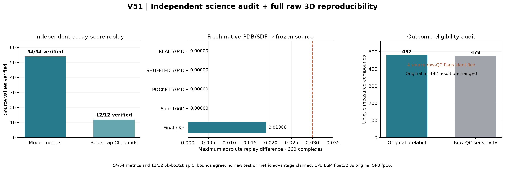

# Reproduce DynaCPI-3D from raw bound structures

**New entry point:** `predict_raw.py` processes original SMILES + crystal ligand SDF + protein-complex PDB directly. It derives the correct receptor CA sequence, computes the **original** frozen ESM2-650M embedding, DAVIS v5 423D backbone, all three original 704D geometry arms and the fourfold HiQBind349 TRAIN-fitted 3D residuals. It never accesses assay labels.

## Install

Python 3.11 with `pip install -r requirements-raw.txt`. Dependency versions used for the verified fresh-vEnv CPU replay include **RDKit 2025.09.2** and **fair-esm 2.0.0**. The actual tested fresh virtual environment inherited global CPU PyTorch/NumPy/SciPy/LightGBM/scikit-learn packages; a fully isolated reinstall on another computer is **not** claimed.

## Input

Use [the template](examples/raw_manifest.template.csv) with columns:

```csv
sample_id,smiles,ligand_sdf,complex_pdb,assay_type,sequence,receptor_chain
```

Only sample_id, smiles, ligand_sdf, complex_pdb are required. Other fields: assay_type KD (default) or KI; sequence and receptor_chain optional. Paths are relative to the manifest. **Ligand SDF must contain the experimentally bound 3D pose and match the same ligand in complex PDB**; stereo identity, contact geometry, and receptor sequence are independently verified. The script rejects numerical Y or assay-affinity columns. It does **not** predict docking poses or generate 3D coordinates from SMILES.

## Model weights

These large originals are **not** in the public repo. You must supply them from authorized downloads or the preserved local research project:

- Original FAIR `esm2_t33_650M_UR50D.pt`, SHA256 `ea9d0522b335a8778dea6535a65301f10208dece28cd5865482b0b1fc446168c` (~2.6 GB).
- DAVIS 68 source-ligand SMILES JSON and original Dyna v5 seed2931 and seed2932 checkpoints. Both are SHA-pinned in code.
- Source TRAIN349 fourfold calibrated model folder (`run.json`, 12 residual `.pt` weights, LightGBM calibrators and feature standardizers). `prepare.py` + `train.py` can reconstruct this from permitted local source TRAIN349 data. No private training labels or weights are redistributed.

## Command

```powershell
python predict_raw.py `
  --manifest private\raw_cases.csv `
  --esm-checkpoint "C:\path\esm2_t33_650M_UR50D.pt" `
  --davis-ligands "C:\path\ligands_can.txt" `
  --davis-model-2931 "C:\path\centered_esm_mse_seed2931.pt" `
  --davis-model-2932 "C:\path\centered_esm_mse_seed2932.pt" `
  --trained-residuals runs\v48_train349_source_fourfold_replay `
  --out runs\new_raw_predictions.csv `
  --features-out private\raw_features_noY.npz `
  --esm-device cpu
```

Output: `sample_id,raw_davis_v5,calibrated_2d,real_3d,shuffled_3d,pocket_only`, plus a SHA-256 provenance JSON. Feature output is optional, label-free and locally private; it stores `x2d(N,423)` and `real/shuffled/pocket(N,704)`. Outputs are never overwritten.

## Reproducibility verified

- `src/dynacpi3d/geometry.py` is a byte-identical copy of original V16 pair-feature encoder, SHA256 `465aeb2cb971ba332a75d7e622a2d1d84bf0947aa827278730020e659792e727`.
- V51 independent experimental audit replayed original 482 OpenBind pKd cases, all 54 aggregate metric checks and 12 fixed 5,000-draw scaffold CI endpoints, max CI drift `2.1e-15`.
- Fresh CPU Python3.11 with matching RDKit checked 30 genuine unseen-at-training OpenBind native structures: all three 704D features and 166D side inputs **exactly identical** to the original source; max final model prediction difference **0.01025 pKd**, below predeclared 0.03 threshold. ESM GPU half versus fresh CPU float32 is not bitwise identical.
- **Complete original OpenBind raw660 replay passed**, not just a subset: 660/660 actual X-ray SDF+PDB+SMILES were re-parsed in the new venv, including all six original receptor sequences. All REAL, SHUFFLED, POCKET 704D geometry vectors and all 166D side features were **exactly equal** to the original frozen V50 source. Across all five Dyna model output arms, the worst observed difference was **0.01886 pKd**, and the largest average absolute difference per arm was **0.001615 pKd**, meeting predeclared 0.03 max/0.01 mean tolerances. The 423D context max difference was 0.01867, reflecting CPU fp32 ESM vs original GPU fp16. This check never opened experimental OpenBind Kd/pKd.
- The released `results/v51_scientific_audit_and_raw_reproducibility.json` summarizes independent score/CI replication and full raw660 parity, including source SHA identifiers; the original 660 row-level inputs and outputs remain private.



**Limits:** This validates native-bound structural *inference*, not raw-PDB retraining of original DAVIS + ESM backbone, fully hermetic cross-platform installs, pose-free prospective candidate prediction, or a general SOTA result. The independent OpenBind source failed the original primary geometry-MAE criterion and Dyna REAL's absolute RMSE was worse than raw 2D and original Perceiver.
