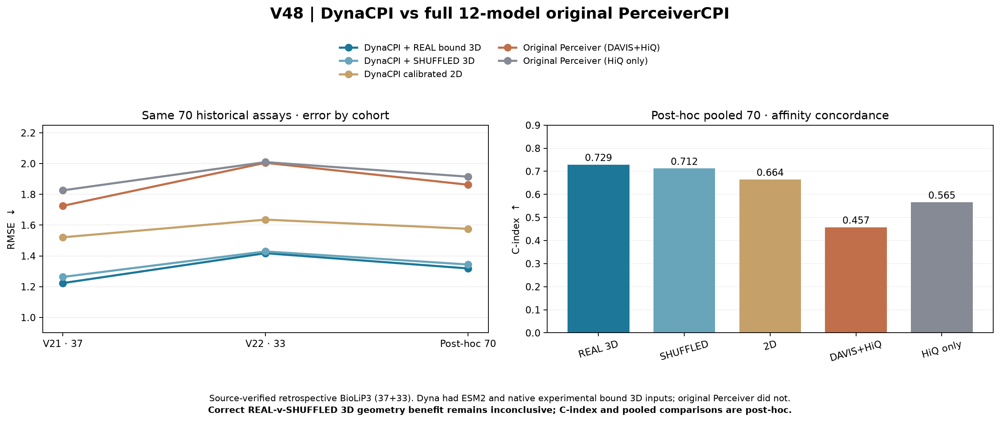
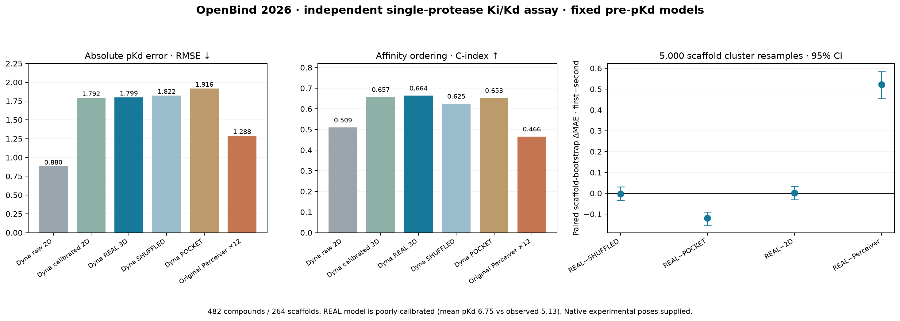

# GeoFuse-CPI (GeoFuse-3D)

**Native structure-augmented compound–protein affinity prediction.**

A frozen **DynaCPI v5** protein/compound backbone with a small **47,361-parameter, geometry-conditioned residual**. Evaluated against the original [PerceiverCPI](https://github.com/dmis-lab/PerceiverCPI) on historical BioLiP3 complexes **and a new single-target OpenBind 2026 experimental cohort**.



## Model

```text
SMILES + protein sequence → pretrained DynaCPI v5 → 423D context → 2D calibrator
                                                       +
native experimental ligand–pocket 3D → 704D contact/angle features → residual MLP
                                                       ↓
                                                predicted pKi/pKd
```

The geometry head is **704 → 64 → 32 → 1**, with `0.5 × tanh` bounded output. Its weights and old-source fourfold LightGBM calibration are fit on **HiQBind TRAIN349**, not on the evaluated BioLiP3 outcomes.

## Results

| Model | BioLiP3 first 37 RMSE ↓ | Second 33 RMSE ↓ | Pooled 70 RMSE ↓ | Pooled C-index ↑ |
|---|---:|---:|---:|---:|
| **DynaCPI + real native 3D** | **1.223** | **1.418** | **1.318** | **0.729** |
| DynaCPI + shuffled geometry | 1.263 | 1.429 | 1.344 | 0.712 |
| DynaCPI calibrated 2D | 1.521 | 1.636 | 1.576 | 0.664 |
| Original PerceiverCPI **DAVIS-pretrained**, 12 models | 1.725 | 2.005 | 1.862 | 0.457 |
| Original PerceiverCPI, HiQBind-only, 12 models | 1.826 | 2.010 | 1.915 | 0.565 |

**49.9% lower observed pooled MSE** than the original 12-model PerceiverCPI with **matched DAVIS supervised source data**; 52.6% lower than its HiQBind-only version. The latter two are separate pretrained configurations, not a controlled pretraining ablation. Both cohorts come from the **same** BioLiP3 source; pooled results, C-index and the fully pretrained comparison are **post-hoc**. **Real vs shuffled 3D is inconclusive.** DynaCPI still has ESM2-650M pretrained features and experimental bound-pose input that Perceiver does not, so this is **not** equal-input architecture proof or the official DAVIS/KIBA/METZ fivefold benchmark.

## Independent external test — OpenBind 2026

All models were **frozen before experimental pKd values were opened**. After predeclared structure/chemical quality checks, 482 compounds across 264 scaffolds qualified from a new 2A protease campaign.

| Model | RMSE ↓ | C-index ↑ |
|---|---:|---:|
| Raw DynaCPI v5 2D | **0.880** | 0.509 |
| Original PerceiverCPI, DAVIS+HiQ, full 12 models | 1.288 | 0.466 |
| Calibrated DynaCPI 2D | 1.792 | 0.657 |
| **DynaCPI REAL native 3D** | 1.799 | **0.664** |
| DynaCPI SHUFFLED geometry | 1.822 | 0.625 |
| DynaCPI POCKET-only | 1.916 | 0.653 |

REAL 3D improved C-index over SHUFFLED by **+0.0392** (5k paired scaffold-bootstrap 95% interval **[+0.0203,+0.0562]**) and MAE over POCKET by **−0.1192** (interval **[−0.1522,−0.0894]**). But REAL vs SHUFFLED **MAE was inconclusive**; our predeclared two-control geometry criterion was **not met**. REAL 3D also has **substantially worse RMSE** than the raw 2D and original Perceiver baselines on this new source. This study is **one target family with native experimental poses**, not a generalized blind SOTA win.



## Install

```bash
python -m pip install -r requirements.txt
python verify.py
python tests/smoke_test.py
```

## Train and predict

Inputs are **precomputed** 423D frozen DynaCPI v5 features and 704D native geometry, **not raw SMILES/PDB files**. `prepare.py` can import the original frozen TRAIN349 features *locally* from the preserved research clone. No raw assays or pretrained ESM2 weights are distributed here.

```bash
# Optional: use the original PRIVATE, frozen source TRAIN349 + split manifest
python prepare.py --source-root ../DynaCPI-3D-RnD --out private
python train.py --data private/train349.npz --splits private/folds349.npz --out runs/native
python predict.py --data private/external37_NO_Y.npz --checkpoint runs/native --out runs/external37.csv
```

For a new dataset, supply an NPZ with `x2d[N,423]`, `real[N,704]`, `shuffled[N,704]`, `pocket[N,704]`, `groups[N]`, and **source TRAIN-only** `y[N]`. For inference supply the same features without any `y`. Model inference requires experimentally observed **bound** ligand poses; this project does not predict docking poses.

## Raw bound-structure inference (no prepared features)

The new `predict_raw.py` reads **SMILES + native ligand SDF + protein-complex PDB** directly, derives the protein sequence, then runs original ESM2-650M, DynaCPI v5 and 3D REAL/SHUFFLED/POCKET models. It requires original separately supplied pretrained weights and verified source-trained HiQBind349 residuals; no experimental assay labels.

```bash
python -m pip install -r requirements-raw.txt
python predict_raw.py --help
```

**Verified:** all 660 OpenBind native-bound complexes reproduced exactly the original REAL/SHUFFLED/POCKET geometry and chemical-side features; all five model outputs matched within **0.01886 pKd** maximum in a fresh CPU environment. The independent audit rechecked **54 metrics and 12 bootstrap intervals**. See [raw input, weights and audit](RAW_REPRODUCIBILITY.md), [input template](examples/raw_manifest.template.csv) and [aggregate audit proof](results/v51_scientific_audit_and_raw_reproducibility.json). No docking or prospective pose prediction is implied.

## Verify and evaluate

```bash
# Check architecture + aggregate arithmetic; optional full original summary hash checks
python verify.py --source-root ../DynaCPI-3D-RnD

# On your own authorized labels: CSVs with sample_id,label and sample_id,prediction
python evaluate.py --labels YOUR_LABELS.csv --predictions YOUR_FROZEN_PREDICTIONS.csv
```

The verification command checks **published aggregate source hashes**, not hidden per-record test labels. On the preserved TRAIN349 features and fixed old group folds, this compact implementation **reproduced all 12 original geometry-model weight tensors exactly** and all **37 original label-free REAL-3D predictions exactly** (maximum difference 0; source SHA proofs in `results/prepared_feature_exact_replay.json`). Repeating that parity in another environment requires the original prepared features and frozen split manifest.

## Reproducibility & status

- `model.py`: actual bounded residual network; `train.py`, `predict.py`: small runnable feature-level entry points; `evaluate.py`, `verify.py`: metrics and SHA/aggregate checks.
- `results/`: frozen BioLiP3 and OpenBind 2026 aggregate metrics, full DAVIS-matched original Perceiver comparison, and exact source-feature training/prediction parity proof. **No individual assay labels.**
- [Methods, data provenance and limitations](METHODS.md) · [Additional evidence](figures/).
- **Completed:** original Perceiver DAVIS source-matched 12-model comparison; 12 exactly reproduced 3D checkpoint states; an independent OpenBind 482-compound single-target experimental test with all model predictions SHA-frozen before outcome release. The OpenBind outcomes are now **consumed**, not reusable as a fresh blind test. This cohort shows geometry-related ranking gains but **does not validate broad architecture accuracy or the strict primary 3D criterion**. Original reserved DAVIS/HiQ/ATOM3D/DockBind/LP/PLINDER test labels remain sealed.

**Research code and results are not clinical decision-support software.** Original PerceiverCPI source © its respective authors; no authorship or official benchmark endorsement is claimed.

## Local demonstration frontend

**New: verified two-branch integration.** For exact SMILES plus receptor-sequence matches in the local native-bound OpenBind reference set, the React frontend now calls `demo/geocpi_bridge.py` to fuse the frozen DynaCPI v5 423D source-calibrated branch with the 704D experimental geometry residual branch. If no qualified native pose is present, the UI labels the result **2D-only** and does not invent a 3D prediction. See [demo integration](demo/README.md) for API wiring and constraints.

The source code for the optional React interface and native-bound example API is in `demo/`. It is **not** a complete portable deployment: the native-bound API needs privately held, trained source-only checkpoints and example feature inputs, while the normal SMILES/sequence path uses a separate DAVIS v6 backend not shipped here. Do not treat the default interface as a working end-to-end 3D prediction from SMILES alone. The project includes no private assays, weights, ESM2 checkpoints, or full research datasets.

The published code is research-only; before public deployment add authentication, rate limiting, secure CORS and dependency security review.
